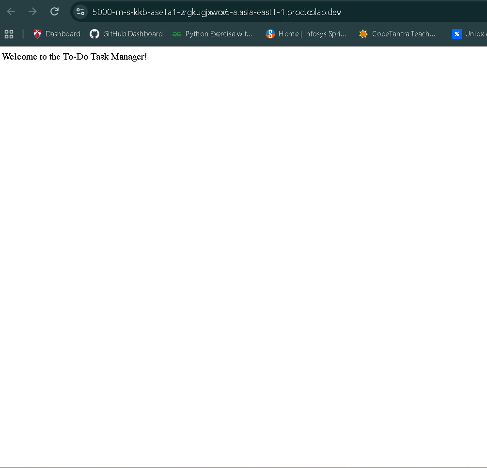
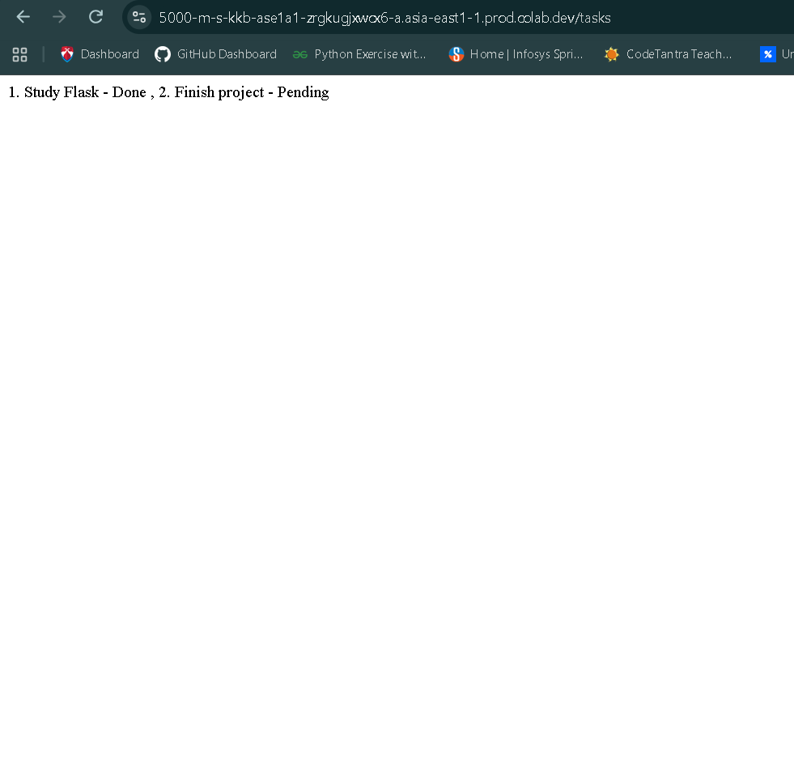
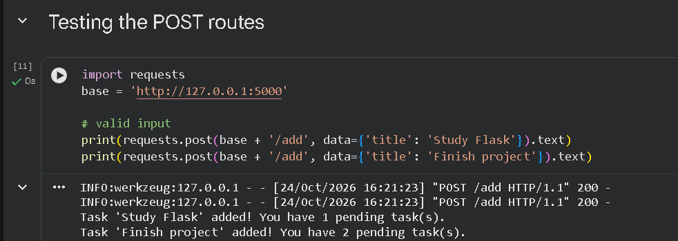
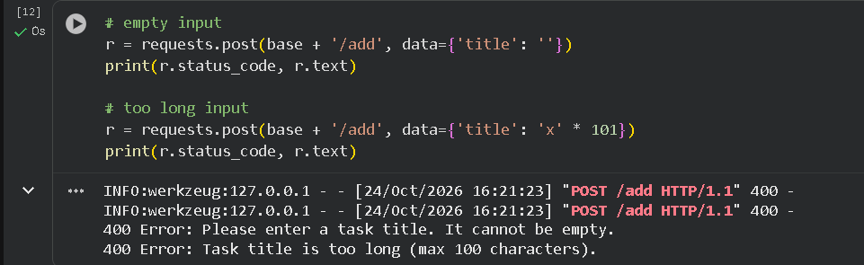

# To-Do Task Manager (Flask Mini Project)

**Name:** Rohan Jha
**Course:** Unlox Minor Project: Flask Mini Project

A simple To-Do / Task Manager built with Python Flask. This version has no HTML templates: the routes return plain text, and the POST routes are tested with the `requests` library.

## Features
- Add a task
- View all tasks with Done / Pending status
- Mark a task as done
- Input validation with friendly error messages (empty title, title longer than 100 characters, task not found)
- Tasks are stored in a Python list (no database), so they reset when the app restarts

## Project Files
```
app.py                    Flask application (all routes)
ToDo_Flask_Simple.ipynb   Google Colab notebook (runs the app and tests the POST routes)
requirements.txt          Python packages needed
screenshots/              Screenshots of the working app
README.md                 This file
```

## Routes
| Route | Method | What it does |
|-------|--------|--------------|
| `/` | GET | Welcome message |
| `/tasks` | GET | Shows all tasks with their status |
| `/add` | POST | Adds a task (form field: `title`) and shows a confirmation |
| `/complete/<id>` | POST | Marks the task with that id as done |

## How to Run

### Option 1: Google Colab (easiest)
1. Open `ToDo_Flask_Simple.ipynb` in Google Colab.
2. Click **Runtime > Run all**.
3. Click the link printed under the server cell to open the app and view the GET routes (`/` and `/tasks`).
4. The test cells at the bottom send POST requests and print the results.

### Option 2: On your computer
1. Install the requirements: `pip install -r requirements.txt`
2. Start the app: `python app.py`
3. Open `http://127.0.0.1:5000/` and `http://127.0.0.1:5000/tasks` in your browser.
4. To test a POST route, open a second terminal and run:
   ```
   python -c "import requests; print(requests.post('http://127.0.0.1:5000/add', data={'title': 'Study Flask'}).text)"
   ```

## Testing Done
- App starts without errors
- `/` and `/tasks` open in the browser
- Valid tasks are added: "Task 'Study Flask' added! You have 1 pending task(s)."
- Empty title returns: "Error: Please enter a task title. It cannot be empty."
- Title longer than 100 characters returns: "Error: Task title is too long (max 100 characters)."
- A task can be marked as done and shows as "Done" on `/tasks`
- Completing a task that does not exist returns "Error: Task not found."

## Screenshots

### Home page (`/`)


### Task list (`/tasks`)


### Adding valid tasks (POST `/add`)


### Validation errors (empty and too-long input)

